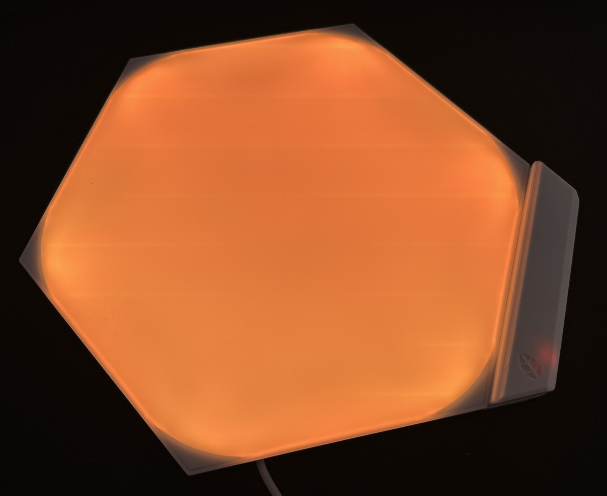
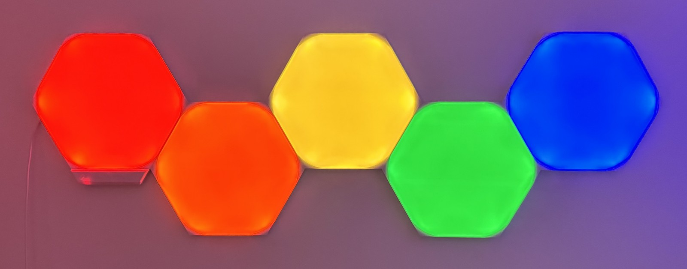
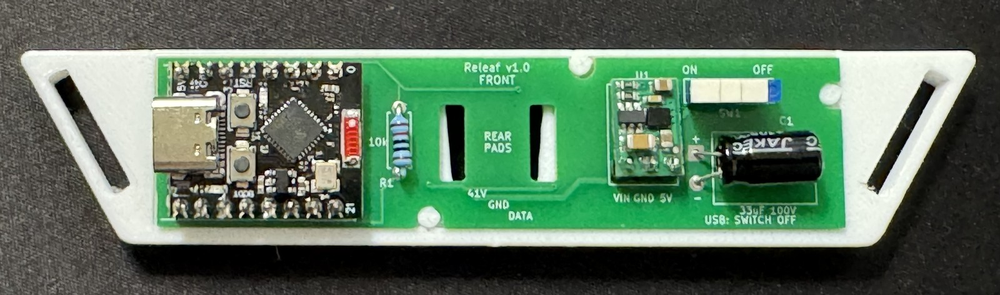
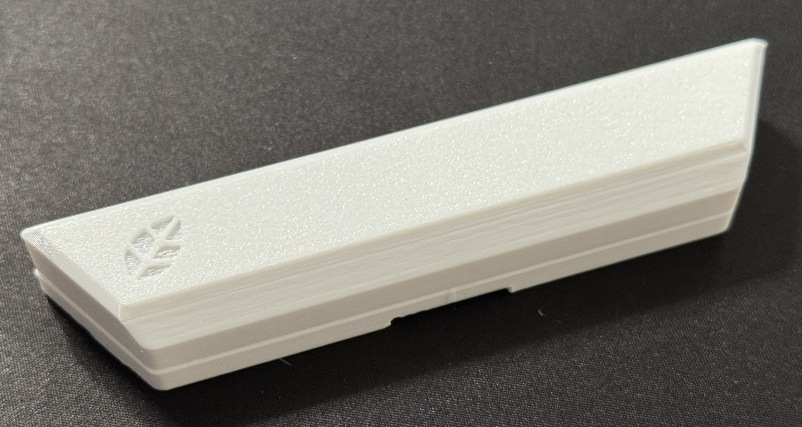
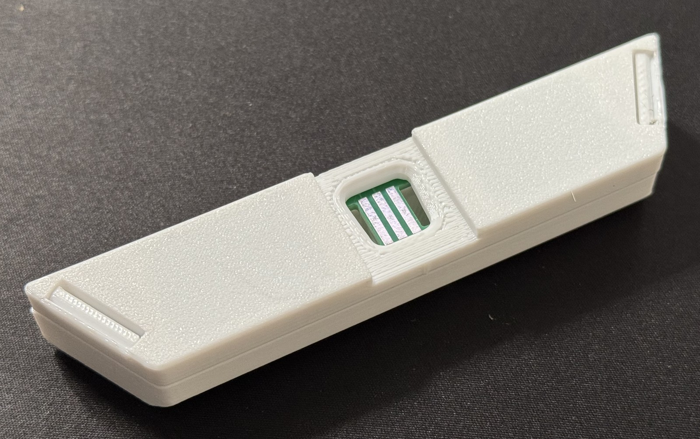
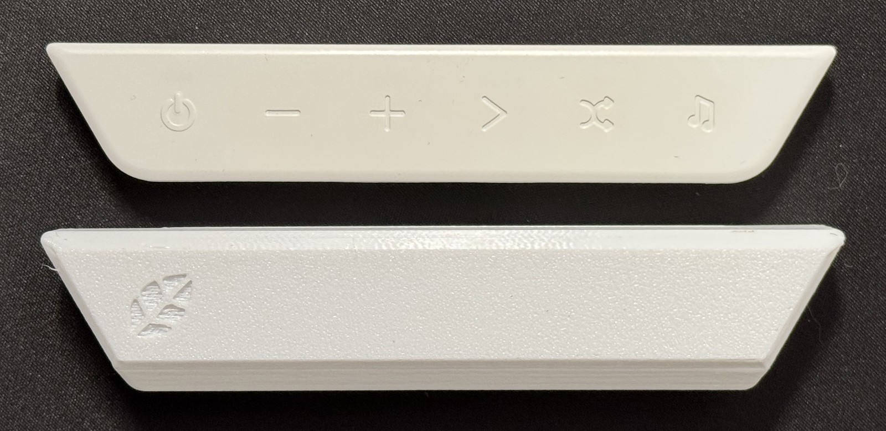
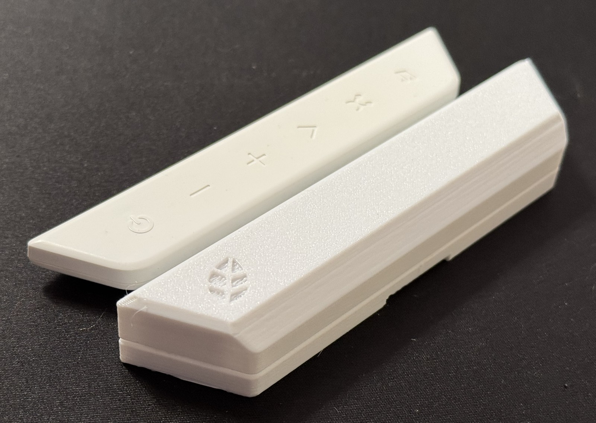
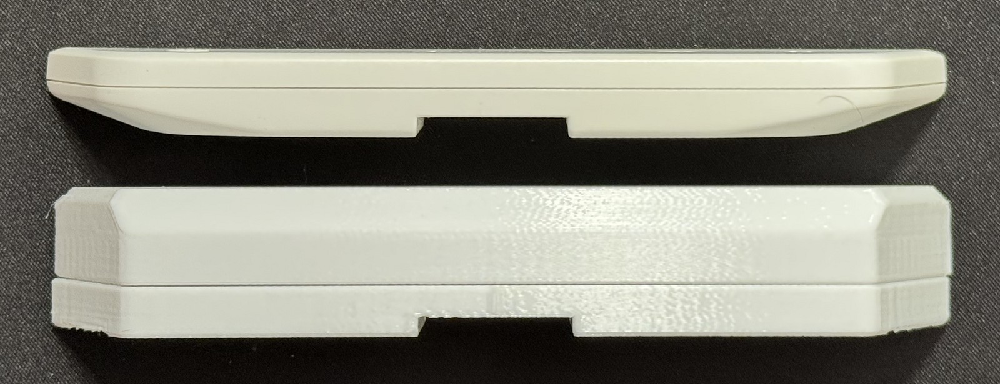

# Releaf

**[Downloads](https://github.com/nikolak/releaf/releases)** · [Getting started](#getting-started) · [Firmware](firmware/README.md) · [PCB](#optional-controller-board) · [Changelog](CHANGELOG.md)

---

My Nanoleaf Shapes controller died, and I wasn't about to drop €40 just to turn on my perfectly good light panels. So I built Releaf: a cheap, fully local WLED controller based on the C3 SuperMini.

I kept the goals simple:
- Keep it cheap.
- Make it easy to build.
- Use common parts.
- Keep everything local.
- Avoid heavy custom firmware.

I went a step further and made an **optional PCB** that keeps the footprint small. Technically, you just need a C3 SuperMini (about 2 bucks), a resistor (cents), some wire (cents), and either a step-down converter to power the C3 SuperMini via the panel power, or just power it via USB-C if you don't mind the extra cable. The full build with the PCB and everything comes to about €7-€9 depending on where you source your hardware, shipping costs, etc.

| | |
| --- | --- |
|  |  |

## Downloads

No need to compile the firmware yourself—just grab the binaries from the [latest releases](https://github.com/nikolak/releaf/releases):

| File | What it's for |
| --- | --- |
| `releaf-esp32c3-factory.bin` | First installation over USB, including the bootloader and partition table |
| `releaf-esp32c3.bin` | Updating an existing Releaf installation through WLED |
| `releaf-gerbers.zip` | Ordering the optional PCB |
| `releaf-shell.3mf` | 3D printing the shell (Bambu Studio project with both halves). The STEP files are in [hardware/shell](hardware/shell). |

The [firmware instructions](firmware/README.md#installing-a-release) cover flashing the downloaded files. Changes between versions are in the [changelog](CHANGELOG.md).

## Getting started

You can wire this directly, use a breadboard, or make the [controller board](#optional-controller-board) below. The firmware is the same for all three.

1. Grab a release and follow the [firmware instructions](firmware/README.md#installing-a-release) to flash the C3. You can also [build from source](firmware/README.md#building-from-source).
2. Swap the cables: disconnect the original Nanoleaf controller and connect the C3 using the [wiring below](#wiring). The panels still use their original power supply.
3. Power on the C3 and connect to **WLED-AP** (password: `wled1234`). Open [4.3.2.1](http://4.3.2.1) and enter your Wi-Fi details.
4. Open WLED at its network address, set the LED count to the number of panels, and restart the C3 so it can discover the layout. From there, you can use WLED's effects and presets as usual.

## Wiring

Connect the C3 to the panels like this:

| C3 connection | Panel connection |
| --- | --- |
| GPIO4 (TX) and GPIO5 (RX) | Both connect to DATA |
| 3.3 V through a 10 kΩ resistor | DATA (the pull-up resistor) |
| GND | GND |

WLED still needs a configured LED output, so GPIO10 is used as a dummy output. Leave it unconnected; the panels communicate through GPIO4 and GPIO5.

You can power the C3 through USB-C, or use a step down converter to get 5 V from the panel supply. **Crucial: Do not connect the panel's 41–42 V supply directly to the C3. Double-check the pinout as the linkers swap the 41v and DATA positions.**

## Optional controller board

The PCB integrates the C3 and power management into one board. It draws power directly from the panels, converting it to 5V for the C3 so you don't need an extra USB cable. All five components are through-hole and can be soldered by hand:

- ESP32-C3 SuperMini
- Pololu D45V5F5 converter
- ESP1010 switch
- 10 kΩ resistor
- 33 µF / 100 V capacitor

The [Gerber files](hardware/releaf-gerbers.zip) are ready for production. The board is 80 × 20 mm, two layers, and 1.6 mm thick. If you want to change the design, open [releaf.kicad_pro](hardware/releaf.kicad_pro) in KiCad 10.

The PCB hasn't been built yet, so it's still a prototype.

When using the board, **switch it OFF before connecting USB, and unplug USB before switching it back ON.**

### Shell

A two-part printed shell holds the board and clips onto a panel with a standard linker. The files and print notes are in [hardware/shell](hardware/shell/README.md).

| Front | Back |
| --- | --- |
|  |  |

Next to the original Nanoleaf controller (top):

| From the front | At an angle | From the side |
| --- | --- | --- |
|  |  |  |

## Credits

The firmware is [WLED](https://github.com/wled/WLED), with a Shapes usermod adapted from [Cptmeme's Nanoleaf Shapes controller](https://github.com/Cptmeme/Nanoleaf-Shapes-controller/tree/65466c8d1d78132e2a151831517c090b4cc58161) for the ESP32-C3 SuperMini. WLED provides the effects, presets and web interface.

[MyrikLD's LeafBus](https://github.com/MyrikLD/LeafBus) documents the panel communication in [PROTOCOL.md](https://github.com/MyrikLD/LeafBus/blob/c40f929b5c09581beaedb593cc834cef8044b787/PROTOCOL.md).

## License

The original Releaf hardware and project files are [MIT licensed](LICENSE). The Shapes usermod keeps its upstream [GPL-3.0 license](firmware/LICENSE).
